  

###

  

###

<h1 data-importer="text" align="center">hello there 👋</h1>

###

<h3 data-importer="text" align="left">👩‍💻  Hakkımda</h3>

###

Ben Enes Kurucu  - Oyun Geliştiriyorum - 📚 Kodlama Öğreniyorum

###
| Proje İsmi | Açıklama | Teknoloji |
|:---|:---|:---|
| **[Dopamed](https://github.com/Enoli13/Dopamed)** | Ders PDF'lerini, slaytları ve çıkmış soruları Shorts tarzı kısa kartlara, süreli düelloya ve aralıklı tekrara çeviren "sağlıklı brainrot" çalışma uygulaması ([APK](https://github.com/Enoli13/Dopamed/releases/latest)) | `JavaScript` `Capacitor` `Android` |
| **[Odak-Enoli13](https://github.com/Enoli13/Odak.git)** | Odak ve verimli telefon kullanımı için tasarlanmış android uygulama | `Kotlin` |
| **[Anki-Android (Odak fork)](https://github.com/Enoli13/Anki-Android)** | Odak özelliklerinin AnkiDroid fork'una taşınmış hali; kartlar Anki destelerinden gelir | `Kotlin` `Android` |
| **[esp32-marauder-panel](https://github.com/Enoli13/esp32-marauder-panel.git)** | Esp32 Marauder projesi için türkçe grafik arayüz panel | `Python` `Shell` |
| **[enolink-Turkce-Ink-Alternatifi](https://github.com/Enoli13/enolink-Turkce-Ink-Alternatifi.git)** | Metinleri, seçenekleri ve seneryoları Unity'e entegre eden Türkçe yazılım | `C#` `JavaScript` `Electron` |
| **[Msi-Fan-Control-Center](https://github.com/Enoli13/msi-control-center-Fan.git)** | Arch tabanlı linux kullanan msi laptoplar için fan kontrol sistemi | `Python` `PySide6` |
| **[Freedom-Lock](https://github.com/Enoli13/Ozgurluk-Kilidi-Freedom-Lock.git)** | Telefondaki Seçilen Uygulamalar Hariç Diğer Hiçbir Özelliği Kullanmanıza İzin Vermeyen Detox Kilidi | `Kotlin` `Android` |

<h1 data-importer="text" align="center">🛠 Diller ve Araçlar | Language and tools</h1>

###

  
  
  
  
  
  
  
  
  
  
  
  
  
  
  
  
  
  
  
  
  
  
  
  
  
  
  

###

<h3 data-importer="text" align="left">İstatistik | My Stat:</h3>

###

  

###

<picture data-importer="pacman">
  <source media="(prefers-color-scheme: dark)" srcset="https://raw.githubusercontent.com/Enoli13/Enoli13/pacman-output/pacman-contribution-graph-dark.svg?game=pacman">
  <source media="(prefers-color-scheme: light)" srcset="https://raw.githubusercontent.com/Enoli13/Enoli13/pacman-output/pacman-contribution-graph.svg?game=pacman">
  
</picture>

###

  

###
